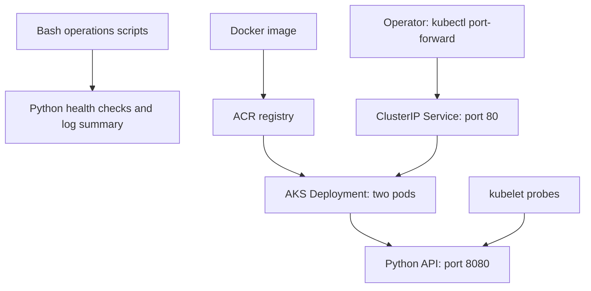

# CloudOps Sentinel

**Linux operations toolkit + Python health API + Kubernetes recovery lab + Azure AKS deployment path.**

Built to connect Linux administration, Bash, Python, Azure and Kubernetes in one explainable operations project. The scenario: an operations engineer needs to check a Linux system, diagnose an unhealthy workload, summarize HTTP errors, and recover a failed deployment without guessing.

This is a portfolio lab, not a production monitoring product. See [verification evidence](evidence/VERIFICATION.md) for exactly what has actually run. No Azure deployment is claimed.

## Interactive browser demo

The `web/` directory contains a lightweight Vercel-hostable incident simulator with four scenarios, a safe practice terminal, saved local progress and incident JSON export. All browser metrics are illustrative. The real Python and Kubernetes tools run separately.

## What it does

- Collects disk usage, Linux memory utilization and one-minute load average.
- Returns JSON and useful exit codes for shell automation.
- Captures read-only Linux triage reports with private file permissions.
- Serves separate liveness, readiness and diagnostic HTTP endpoints.
- Summarizes structured HTTP logs, including malformed-record accounting.
- Runs as a non-root container with a read-only root filesystem in Kubernetes.
- Deploys two replicas through a ClusterIP Service, with bounded CPU/memory and rolling updates.
- Exercises readiness failure/recovery, deleted-pod replacement, and explicit rollback after a broken image release on kind.
- Provides opt-in Azure CLI scripts for ACR + AKS, restricted API access and scoped cleanup.
- Includes GitHub Actions for Python tests, ShellCheck, image build, kind deployment, smoke checks and recovery drills.

## Start without Docker or an Azure account

Requirements: Linux/WSL2, Python 3.12+, Bash. Runtime Python dependencies: **none**.

```bash
git clone https://github.com/kushagrapandey-cmd/Devops-Learning.git
cd Devops-Learning/projects/cloudops-sentinel
bash scripts/verify.sh
bash scripts/host-check.sh
python3 -m sentinel.server
```

In another terminal:

```bash
curl -fsS http://127.0.0.1:8080/healthz
curl -fsS http://127.0.0.1:8080/readyz
curl -fsS http://127.0.0.1:8080/api/status
```

Stop with Ctrl+C. Exit `1` from host-check means an alert, not a broken script; `2` means collection/input failure. A memory or disk alert does not automatically make a pod unready: restarting healthy processes during a capacity incident can worsen it.

## Run Kubernetes locally

Install Docker Engine (or Docker Desktop with WSL integration), kubectl and kind using their official installation instructions. Check `docker info`, `kind version`, `kubectl version --client` first. The local cluster consumes RAM/CPU; the Python-only path is lighter.

```bash
bash scripts/local-cluster.sh
kubectl --context kind-sentinel -n sentinel port-forward svc/sentinel 8080:80
# Separate terminal; stop port-forward before running disruptive drills.
curl -fsS http://127.0.0.1:8080/api/status
bash scripts/drills.sh
bash scripts/diagnose.sh sentinel
# Clean up local containers when finished:
kind delete cluster --name sentinel
```

The drills intentionally change workloads and only accept context `kind-sentinel`. Do not reuse that context name for a real environment. Port-forward uses one selected pod, so it does not prove load balancing or zero downtime.

## Architecture



The same image can run on local kind or optional AKS. Host scripts run separately on a Linux machine; this is not a privileged DaemonSet monitoring every node. The diagram shows the intended Azure path, not evidence of a live Azure deployment.

## Read this in order

1. [Complete walkthrough](docs/WALKTHROUGH.md): every file, execution path, commands and design decisions.
2. [Hands-on demo](docs/DEMO.md): a reproducible presentation and fault exercises.
3. [Azure deployment](docs/AZURE.md): billable lab, identity, image flow and cleanup.
4. [Operations runbook](docs/RUNBOOK.md): investigate common failures.
5. [Interview guide](docs/INTERVIEW.md): architecture explanation, questions and honest claims.
6. [Verification](evidence/VERIFICATION.md): executed versus unexecuted checks.

## Scope and trade-offs

The API intentionally uses Python's standard library for easy inspection. `http.server` is suitable for this internal lab, not an internet-facing service. There is no authentication, TLS, persistent database, alert delivery, Prometheus/Grafana, real-time dashboard, multi-node HA or automated Azure CD. There is no secret embedded in the source.

Memory/load readings in a container are host-visible and are **not** cgroup utilization. Disk usage describes the filesystem containing `/`; inside an overlay container this is not all host disks. `load_1m` is a queue/load measure, not CPU percent. Reports are instantaneous; the project does not claim historical monitoring or an SLO.

One AKS node is a cost-conscious lab choice, not high availability. Two pods on the same node do not survive node loss. AKS control-plane Free tier does not make worker VMs, disks, ACR or network traffic free. Azure provisioning is manual and explicitly opt-in.

This project was built with AI assistance. The repository documents implementation and tests; personal hands-on proficiency is demonstrated by reproducing the exercises and explaining the trade-offs.


## Linux VM workbench

[Open the command-driven Linux lab](https://cloudops-sentinel-three.vercel.app/linux.html). Practice service failure, wrong port, network diagnosis and patch maintenance through typed commands and evidence gates. Real Ubuntu systemd install, inspection, config backup/restore and guarded patch scripts live in `linux/`; optional Azure VM Bicep is in `azure/linux-vm/`. Start with [the Hinglish guide](docs/LINUX_VM_LAB.md). No Azure VM deployment is claimed.
