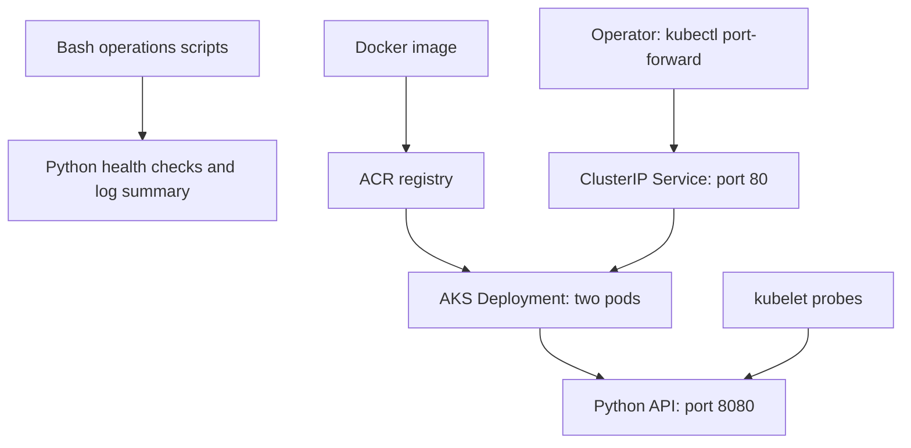

# CloudOps Sentinel

**Linux VM operations + Bash/Python automation + command-driven practice + Kubernetes recovery + optional Azure infrastructure.**

Built to connect Linux administration, Bash, Python, Azure and Kubernetes in one explainable operations project. The scenario: an operations engineer needs to check a Linux system, diagnose an unhealthy workload, summarize HTTP errors, and recover a failed deployment without guessing.

This is a portfolio lab, not a production monitoring product. See [verification evidence](evidence/VERIFICATION.md) for exactly what has actually run. No Azure deployment is claimed.

## One website, two learning labs

| Lab | Open | What you practice |
| --- | --- | --- |
| Kubernetes incident lab | [Main page](https://cloudops-sentinel-three.vercel.app/) | Readiness failure, broken image release, memory-limit concepts and Service selector mismatch |
| Linux VM workbench | [Linux page](https://cloudops-sentinel-three.vercel.app/linux.html) | Typed commands for stopped services, wrong ports, remote connectivity and planned patch maintenance |

Both pages belong to the same website, Vercel project and source directory. Browser outputs are labelled simulations; neither page executes a real shell or controls Azure.

The Linux workbench requires evidence collection before a fix and a successful validation command before closing an incident. It includes command history, hints, explanations, reset and transcript export. The Kubernetes lab includes guided controls, a practice terminal, locally saved scenario/phase and incident export.

Start the Linux workbench by typing `help`. Simulator shortcuts such as `restore-config` and `restore-nsg` are teaching commands; the [Hinglish Linux guide](docs/LINUX_VM_LAB.md) maps the exercises to real procedures.

## What it does

- Collects disk usage, Linux memory utilization and one-minute load average.
- Returns JSON and useful exit codes for shell automation.
- Captures read-only Linux triage reports with private file permissions.
- Serves separate liveness, readiness and diagnostic HTTP endpoints.
- Summarizes structured HTTP logs, including malformed-record accounting.
- Runs as a non-root container with a read-only root filesystem in Kubernetes.
- Deploys two replicas through a ClusterIP Service, with bounded CPU/memory and rolling updates.
- Exercises readiness failure/recovery, deleted-pod replacement, and explicit rollback after a broken image release on kind.
- Provides opt-in Azure CLI scripts for ACR + AKS, restricted API access and scoped cleanup.
- Installs the real Python API as a non-root Ubuntu systemd service with loopback binding.
- Provides Linux inspection, baseline configuration backup/restore and guarded interactive patching scripts.
- Provides Bicep for an optional Ubuntu Azure VM, VNet, subnet, NIC, NSG and public IP; application access uses an SSH tunnel.
- Includes GitHub Actions for Python/JavaScript tests, ShellCheck, Bicep compilation, real systemd recovery, Docker/kind deployment and rollback drills.

## Start without Docker or an Azure account

Requirements: Linux/WSL2, Python 3.12+, Bash. Runtime Python dependencies: **none**.

```bash
git clone https://github.com/kushagrapandey-cmd/Devops-Learning.git
cd Devops-Learning/projects/cloudops-sentinel
bash scripts/verify.sh
bash scripts/host-check.sh
python3 -m sentinel.server
```

In another terminal:

```bash
curl -fsS http://127.0.0.1:8080/healthz
curl -fsS http://127.0.0.1:8080/readyz
curl -fsS http://127.0.0.1:8080/api/status
```

Stop with Ctrl+C. Exit `1` from host-check means an alert, not a broken script; `2` means collection/input failure. A memory or disk alert does not automatically make a pod unready: restarting healthy processes during a capacity incident can worsen it.

## Run the real Linux VM lab

Use a dedicated Ubuntu 24.04 machine with systemd, Python, curl, git, iproute2 and sudo. The installer creates a service account and writes under `/opt` and `/etc`. Run from the project directory:

```bash
sudo bash linux/install.sh --install-dedicated-lab
sudo systemctl status sentinel --no-pager
curl -fsS http://127.0.0.1:8080/healthz
bash linux/inspect.sh
bash linux/patch.sh plan
```

Follow [LINUX_VM_LAB.md](docs/LINUX_VM_LAB.md) for controlled service failures, wrong-port diagnosis, configuration restore, patch maintenance, post-reboot validation and optional Azure provisioning. Patch planning does not install updates; applying upgrades requires an explicit maintenance flag and package review. No script automatically reboots. The configuration backup covers `app.env` only; it is not a package/OS rollback.

The real VM app listens on loopback. Remote access uses SSH forwarding; the simulator's NSG exercise illustrates a separate hypothetical public application path.

## Run Kubernetes locally

Install Docker Engine (or Docker Desktop with WSL integration), kubectl and kind using their official installation instructions. Check `docker info`, `kind version`, `kubectl version --client` first. The local cluster consumes RAM/CPU; the Python-only path is lighter.

```bash
bash scripts/local-cluster.sh
kubectl --context kind-sentinel -n sentinel port-forward svc/sentinel 8080:80
# Separate terminal; stop port-forward before running disruptive drills.
curl -fsS http://127.0.0.1:8080/api/status
bash scripts/drills.sh
bash scripts/diagnose.sh sentinel
# Clean up local containers when finished:
kind delete cluster --name sentinel
```

The drills intentionally change workloads and only accept context `kind-sentinel`. Do not reuse that context name for a real environment. Port-forward uses one selected pod, so it does not prove load balancing or zero downtime.

## Architecture



The same image can run on local kind or optional AKS. Host scripts run separately on a Linux machine; this is not a privileged DaemonSet monitoring every node. The diagram shows the intended Azure path, not evidence of a live Azure deployment.

## Read this in order

1. [Hinglish Linux VM guide](docs/LINUX_VM_LAB.md): start here for command practice, real setup and simple technical explanations.
2. [Build it yourself](docs/BUILD_IT_YOURSELF.md): rebuild the project in small steps.
3. [Complete walkthrough](docs/WALKTHROUGH.md): every file, execution path, commands and design decisions.
4. [Hands-on demo](docs/DEMO.md): a reproducible presentation and fault exercises.
5. [Azure deployment](docs/AZURE.md): billable lab, identity, image flow and cleanup.
6. [Operations runbook](docs/RUNBOOK.md): investigate common failures.
7. [Interview guide](docs/INTERVIEW.md): architecture explanation, questions and honest claims.
8. [Verification](evidence/VERIFICATION.md): executed versus unexecuted checks.

## Scope and trade-offs

The API intentionally uses Python's standard library for easy inspection. `http.server` is suitable for this internal lab, not an internet-facing service. There is no authentication, TLS, persistent database, alert delivery, Prometheus/Grafana, real-time dashboard, multi-node HA or automated Azure CD. There is no secret embedded in the source.

Memory/load readings in a container are host-visible and are **not** cgroup utilization. Disk usage describes the filesystem containing `/`; inside an overlay container this is not all host disks. `load_1m` is a queue/load measure, not CPU percent. Reports are instantaneous; the project does not claim historical monitoring or an SLO.

One AKS node is a cost-conscious lab choice, not high availability. Two pods on the same node do not survive node loss. AKS control-plane Free tier does not make worker VMs, disks, ACR or network traffic free. Azure provisioning is manual and explicitly opt-in.

This project was built with AI assistance. The repository documents implementation and tests; personal hands-on proficiency is demonstrated by reproducing the exercises and explaining the trade-offs.

## Project structure

| Path | Purpose |
| --- | --- |
| `sentinel/` | Python metric collector, HTTP API and log-summary CLI |
| `scripts/` | Host checks, Kubernetes deployment, diagnosis and drills |
| `linux/` | systemd unit, installer, inspection, configuration backup/restore and patch helper |
| `k8s/` | Namespace, Deployment, Service and Kustomization |
| `azure/` | Optional AKS/ACR provisioning and scoped cleanup |
| `azure/linux-vm/` | Optional Ubuntu VM Bicep and deployment helper |
| `web/` | Two pages of the same static website |
| `tests/` | Python integration/guard tests and JavaScript model tests |
| `docs/`, `evidence/` | Learning guides, runbooks and verification records |

## Validation and current limits

```bash
bash scripts/verify.sh
node --test tests/*.test.mjs
```

Node.js is needed for browser model tests, not the Python runtime. Docker, kind and kubectl are needed for local Kubernetes exercises. Azure CLI/Bicep and subscription permissions are needed for optional Azure provisioning.

The [verified Linux extension CI run](https://github.com/kushagrapandey-cmd/Devops-Learning/actions/runs/40630571493) passed 20 Python tests, 18 JavaScript tests, ShellCheck, Bicep compilation, real Ubuntu systemd install/recovery, configuration backup/restore, apt upgrade simulation and the Kubernetes deployment/recovery checks.

Actual Azure VM/AKS provisioning, OS package upgrades and real reboot have not been verified by this build. No data-disk expansion, Azure Backup or multi-VM availability module is implemented. Browser exercises do not establish real infrastructure experience. See [the verification record](evidence/VERIFICATION.md) for evidence and limits.
